

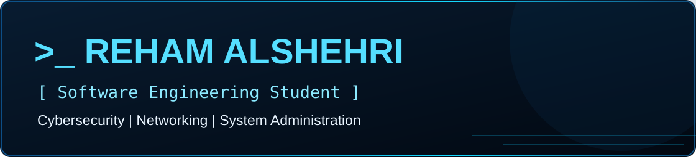

 

## 👤 About Me

<table><tr><td width="57%">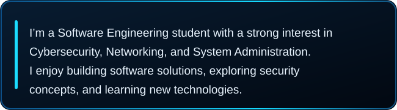</td><td width="43%">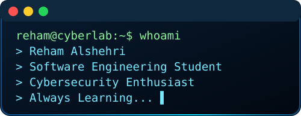</td></tr></table>

## 🛠️ Technical Skills & Tools

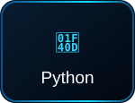
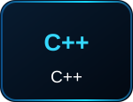
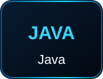
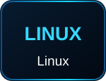

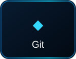
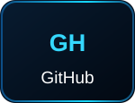
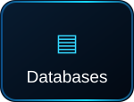

<table width="100%">
<tr>
<td width="50%" valign="top">

<h2>🚀 Featured Projects</h2>

<a href="https://github.com/RehamAlshehri700/IIT-Project">
  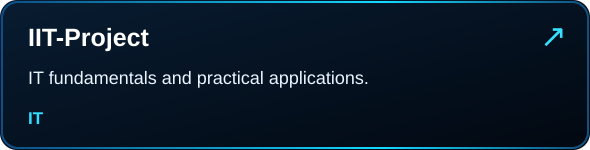
</a>

  

<a href="https://github.com/RehamAlshehri700/Software_tech_assignment-">
  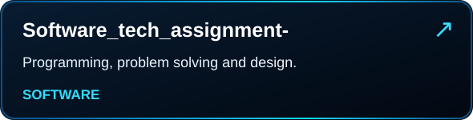
</a>

</td>
<td width="50%" valign="top">
<h2>📊 GitHub Activity</h2>

  

 

 

